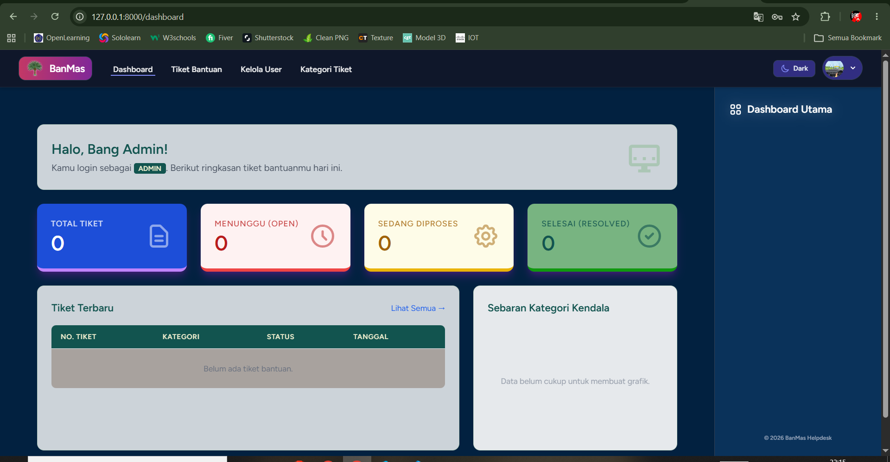
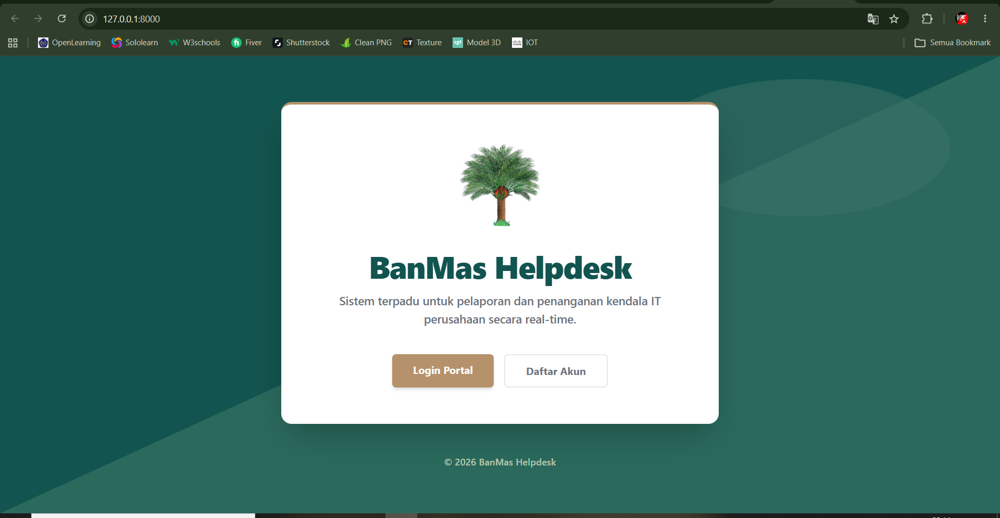
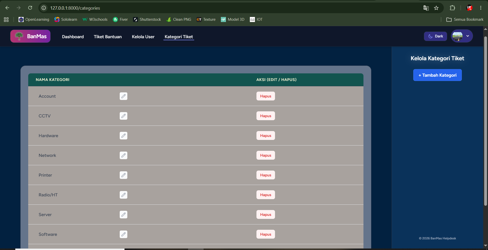
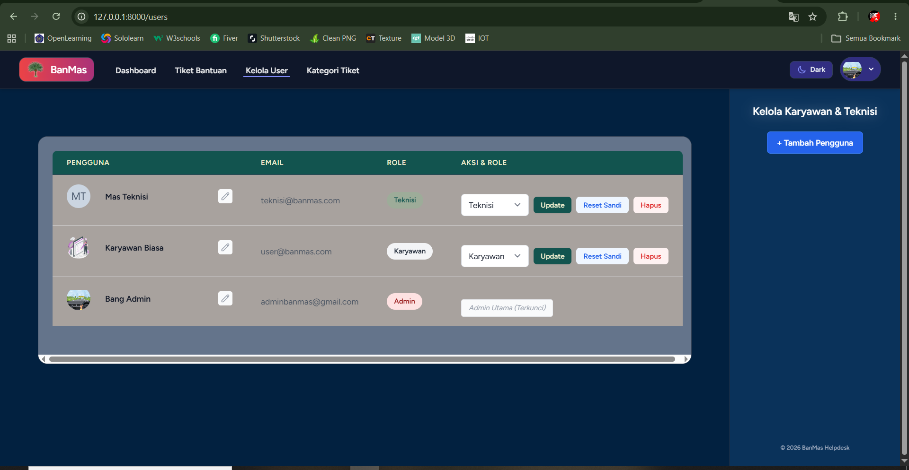

# BanMas Helpdesk

Sistem manajemen tiket bantuan IT (IT Helpdesk) profesional yang dirancang untuk mempermudah pelacakan kendala operasional, pengelolaan status aduan, dan manajemen pengguna berbasis peran (Admin, Teknisi, dan Karyawan).

## 🚀 Fitur Utama
- **Multi-Role Access**: Manajemen hak akses terpisah untuk Admin, Teknisi, dan Karyawan.
- **Sistem Tiket Dinamis**: Pembuatan tiket lengkap dengan kategori, prioritas, dan lokasi perangkat.
- **Lampiran Bukti Multi-Format**: Mendukung pengunggahan foto, dokumen PDF, hingga video kendala.
- **Antarmuka Modern**: Dibangun menggunakan Laravel, Tailwind CSS, dan Alpine.js dengan dukungan *Dark Mode*.

## 📸 Pratinjau Tampilan Aplikasi (Preview)

Berikut adalah beberapa cuplikan antarmuka dari **BanMas Helpdesk**:

### 1. Dashboard Admin

### 2. Tampilan Guest / Pengguna

### 3. Kelola Kategori & User

  
  

